# Database Architecture & Schema Specification

## 1. Overview & Entity Relationship Model

The database is powered by **PostgreSQL 16+** with strict foreign key constraints, UUID primary keys (UUIDv4/UUIDv7), JSONB columns for flexible tool output, and optimized composite indexes for multi-tenant isolation and fast lookup.

```mermaid
erDiagram
    ORGANIZATION ||--o{ ORGANIZATION_MEMBER : has
    USER ||--o{ ORGANIZATION_MEMBER : belongs_to
    ORGANIZATION ||--o{ GITHUB_INSTALLATION : owns
    GITHUB_INSTALLATION ||--o{ REPOSITORY : installs
    REPOSITORY ||--o{ PULL_REQUEST : contains
    PULL_REQUEST ||--o{ PULL_REQUEST_FILE : modifies
    PULL_REQUEST ||--o{ REVIEW : receives
    REVIEW ||--o{ ANALYSIS_JOB : runs
    REVIEW ||--o{ REVIEW_FINDING : produces
    ORGANIZATION ||--o{ AUDIT_LOG : audits
    WEBHOOK_EVENT ||--o| PULL_REQUEST : triggers

    ORGANIZATION {
        uuid id PK
        string name
        string slug UK
        string plan
        datetime created_at
        datetime updated_at
    }

    USER {
        uuid id PK
        string email UK
        string full_name
        string github_user_id UK
        string avatar_url
        datetime created_at
        datetime updated_at
    }

    ORGANIZATION_MEMBER {
        uuid id PK
        uuid organization_id FK
        uuid user_id FK
        string role
        datetime created_at
    }

    GITHUB_INSTALLATION {
        uuid id PK
        uuid organization_id FK
        bigint github_installation_id UK
        string account_login
        string account_type
        text encrypted_access_token
        datetime token_expires_at
        datetime created_at
        datetime updated_at
    }

    REPOSITORY {
        uuid id PK
        uuid organization_id FK
        uuid github_installation_id FK
        bigint github_repo_id UK
        string full_name
        string default_branch
        boolean is_active
        jsonb config_overrides
        datetime created_at
        datetime updated_at
    }

    PULL_REQUEST {
        uuid id PK
        uuid repository_id FK
        integer pr_number
        string title
        string author_github_username
        string head_branch
        string base_branch
        string head_commit_sha
        string state
        datetime created_at
        datetime updated_at
    }

    PULL_REQUEST_FILE {
        uuid id PK
        uuid pull_request_id FK
        string file_path
        string status
        integer additions
        integer deletions
        text patch_content
        datetime created_at
    }

    REVIEW {
        uuid id PK
        uuid pull_request_id FK
        string commit_sha
        string status
        string verdict
        text summary_markdown
        integer total_findings
        integer total_tokens_used
        numeric total_duration_seconds
        datetime started_at
        datetime completed_at
        datetime created_at
    }

    ANALYSIS_JOB {
        uuid id PK
        uuid review_id FK
        string job_type
        string status
        string worker_node
        jsonb raw_output
        text error_message
        datetime started_at
        datetime completed_at
    }

    REVIEW_FINDING {
        uuid id PK
        uuid review_id FK
        string file_path
        integer line_start
        integer line_end
        boolean is_in_diff
        integer diff_position
        string category
        string severity
        numeric confidence
        string source
        string rule_id
        string title
        text description
        text code_evidence
        text suggested_fix
        string status
        datetime created_at
    }

    WEBHOOK_EVENT {
        uuid id PK
        string delivery_id UK
        string event_type
        string action
        string signature_hash
        jsonb payload
        string status
        text error_log
        datetime received_at
        datetime processed_at
    }

    AUDIT_LOG {
        uuid id PK
        uuid organization_id FK
        uuid actor_user_id FK
        string action
        string target_resource
        string target_id
        jsonb details
        string ip_address
        datetime created_at
    }
```

---

## 2. Table Schemas & Definitions

### 2.1 `organizations`
Multi-tenant root entity representing customer accounts.
* `id`: `UUID`, Primary Key, `default=gen_random_uuid()`
* `name`: `VARCHAR(255)`, NOT NULL
* `slug`: `VARCHAR(100)`, NOT NULL, UNIQUE INDEX
* `plan`: `VARCHAR(50)`, NOT NULL, DEFAULT `'free'` (`free`, `pro`, `enterprise`)
* `created_at`: `TIMESTAMPTZ`, DEFAULT `CURRENT_TIMESTAMP`
* `updated_at`: `TIMESTAMPTZ`, DEFAULT `CURRENT_TIMESTAMP`

### 2.2 `users` & `organization_members`
User identity and Role-Based Access Control (RBAC).
* **`users`**:
  * `id`: `UUID`, PK
  * `email`: `VARCHAR(255)`, UNIQUE, NOT NULL
  * `full_name`: `VARCHAR(255)`
  * `github_user_id`: `VARCHAR(100)`, UNIQUE
  * `avatar_url`: `VARCHAR(512)`
  * `created_at`, `updated_at`: `TIMESTAMPTZ`
* **`organization_members`**:
  * `id`: `UUID`, PK
  * `organization_id`: `UUID`, FK (`organizations.id` ON DELETE CASCADE)
  * `user_id`: `UUID`, FK (`users.id` ON DELETE CASCADE)
  * `role`: `VARCHAR(50)`, DEFAULT `'member'` (`owner`, `admin`, `member`, `readonly`)
  * `created_at`: `TIMESTAMPTZ`
  * **Constraint**: `UNIQUE(organization_id, user_id)`

### 2.3 `github_installations`
Tracks GitHub App installations per organization.
* `id`: `UUID`, PK
* `organization_id`: `UUID`, FK (`organizations.id` ON DELETE CASCADE)
* `github_installation_id`: `BIGINT`, UNIQUE, NOT NULL
* `account_login`: `VARCHAR(255)`, NOT NULL (GitHub org/user name)
* `account_type`: `VARCHAR(50)`, NOT NULL (`User`, `Organization`)
* `encrypted_access_token`: `TEXT`, NULL (AES-256-GCM encrypted cached token)
* `token_expires_at`: `TIMESTAMPTZ`, NULL
* `created_at`, `updated_at`: `TIMESTAMPTZ`

### 2.4 `repositories`
Tracked GitHub repositories enabled for code review.
* `id`: `UUID`, PK
* `organization_id`: `UUID`, FK (`organizations.id` ON DELETE CASCADE)
* `github_installation_id`: `UUID`, FK (`github_installations.id` ON DELETE CASCADE)
* `github_repo_id`: `BIGINT`, UNIQUE, NOT NULL
* `full_name`: `VARCHAR(255)`, NOT NULL (e.g. `owner/repo-name`)
* `default_branch`: `VARCHAR(100)`, DEFAULT `'main'`
* `is_active`: `BOOLEAN`, DEFAULT `TRUE`
* `config_overrides`: `JSONB`, DEFAULT `'{}'` (e.g., custom linters enabled, severity floor)
* `created_at`, `updated_at`: `TIMESTAMPTZ`
* **Indexes**: `INDEX idx_repo_org (organization_id)`, `INDEX idx_repo_name (full_name)`

### 2.5 `pull_requests` & `pull_request_files`
* **`pull_requests`**:
  * `id`: `UUID`, PK
  * `repository_id`: `UUID`, FK (`repositories.id` ON DELETE CASCADE)
  * `pr_number`: `INTEGER`, NOT NULL
  * `title`: `VARCHAR(500)`, NOT NULL
  * `author_github_username`: `VARCHAR(255)`
  * `head_branch`: `VARCHAR(255)`
  * `base_branch`: `VARCHAR(255)`
  * `head_commit_sha`: `CHAR(40)`, NOT NULL
  * `state`: `VARCHAR(50)`, DEFAULT `'open'` (`open`, `closed`, `merged`)
  * `created_at`, `updated_at`: `TIMESTAMPTZ`
  * **Constraint**: `UNIQUE(repository_id, pr_number)`
  * **Indexes**: `INDEX idx_pr_repo_sha (repository_id, head_commit_sha)`
* **`pull_request_files`**:
  * `id`: `UUID`, PK
  * `pull_request_id`: `UUID`, FK (`pull_requests.id` ON DELETE CASCADE)
  * `file_path`: `VARCHAR(1024)`, NOT NULL
  * `status`: `VARCHAR(50)` (`added`, `modified`, `removed`, `renamed`)
  * `additions`: `INTEGER`, DEFAULT 0
  * `deletions`: `INTEGER`, DEFAULT 0
  * `patch_content`: `TEXT` (Unified diff hunk text)
  * `created_at`: `TIMESTAMPTZ`

### 2.6 `reviews`
Parent record representing an executed review cycle against a specific commit SHA.
* `id`: `UUID`, PK
* `pull_request_id`: `UUID`, FK (`pull_requests.id` ON DELETE CASCADE)
* `commit_sha`: `CHAR(40)`, NOT NULL
* `status`: `VARCHAR(50)`, DEFAULT `'pending'` (`pending`, `running`, `completed`, `failed`, `cancelled`)
* `verdict`: `VARCHAR(50)`, DEFAULT `'neutral'` (`approved`, `changes_requested`, `comment`, `neutral`)
* `summary_markdown`: `TEXT`
* `total_findings`: `INTEGER`, DEFAULT 0
* `total_tokens_used`: `INTEGER`, DEFAULT 0
* `total_duration_seconds`: `NUMERIC(8,2)`
* `started_at`, `completed_at`: `TIMESTAMPTZ`
* `created_at`: `TIMESTAMPTZ`
* **Indexes**: `INDEX idx_reviews_pr (pull_request_id)`, `INDEX idx_reviews_sha (commit_sha)`

### 2.7 `analysis_jobs`
Sub-jobs executed for a review (e.g. `ruff`, `bandit`, `semgrep`, `llm_review`).
* `id`: `UUID`, PK
* `review_id`: `UUID`, FK (`reviews.id` ON DELETE CASCADE)
* `job_type`: `VARCHAR(50)` (`STATIC_RUFF`, `STATIC_BANDIT`, `SECURITY_SEMGREP`, `AI_SEMANTIC`)
* `status`: `VARCHAR(50)` (`queued`, `running`, `succeeded`, `failed`)
* `worker_node`: `VARCHAR(100)`
* `raw_output`: `JSONB`
* `error_message`: `TEXT`
* `started_at`, `completed_at`: `TIMESTAMPTZ`

### 2.8 `review_findings`
Normalized, deduplicated findings produced by the analysis engines.
* `id`: `UUID`, PK
* `review_id`: `UUID`, FK (`reviews.id` ON DELETE CASCADE)
* `file_path`: `VARCHAR(1024)`, NOT NULL
* `line_start`: `INTEGER`, NOT NULL
* `line_end`: `INTEGER`, NOT NULL
* `is_in_diff`: `BOOLEAN`, DEFAULT `TRUE`
* `diff_position`: `INTEGER`, NULL (GitHub diff line index)
* `category`: `VARCHAR(100)`, NOT NULL (`SECURITY`, `CORRECTNESS`, `PERFORMANCE`, `CONCURRENCY`, `ERROR_HANDLING`, `API_MISUSE`, `MAINTAINABILITY`)
* `severity`: `VARCHAR(50)`, NOT NULL (`CRITICAL`, `HIGH`, `MEDIUM`, `LOW`, `INFO`)
* `confidence`: `NUMERIC(3,2)`, NOT NULL (0.00 to 1.00)
* `source`: `VARCHAR(100)`, NOT NULL (`STATIC_ANALYZER`, `SECURITY_ANALYZER`, `LLM`, `HYBRID`)
* `rule_id`: `VARCHAR(100)` (e.g., `B608`, `RUFF-F841`, `AI-RACE-COND`)
* `title`: `VARCHAR(255)`, NOT NULL
* `description`: `TEXT`, NOT NULL
* `code_evidence`: `TEXT` (Snippet from diff)
* `suggested_fix`: `TEXT` (Suggested replacement code for GitHub suggestions)
* `status`: `VARCHAR(50)`, DEFAULT `'open'` (`open`, `resolved`, `false_positive`, `dismissed`)
* `created_at`: `TIMESTAMPTZ`
* **Indexes**: `INDEX idx_finding_review (review_id)`, `INDEX idx_finding_file_line (file_path, line_start)`

### 2.9 `webhook_events`
Raw audit and idempotency log for incoming GitHub webhooks.
* `id`: `UUID`, PK
* `delivery_id`: `VARCHAR(100)`, UNIQUE, NOT NULL (GitHub `X-GitHub-Delivery`)
* `event_type`: `VARCHAR(100)`, NOT NULL (`pull_request`, `installation`, etc.)
* `action`: `VARCHAR(100)`
* `signature_hash`: `VARCHAR(100)`, NOT NULL
* `payload`: `JSONB`, NOT NULL
* `status`: `VARCHAR(50)`, DEFAULT `'received'` (`received`, `processed`, `failed`, `ignored`)
* `error_log`: `TEXT`
* `received_at`: `TIMESTAMPTZ`, DEFAULT `CURRENT_TIMESTAMP`
* `processed_at`: `TIMESTAMPTZ`
* **Indexes**: `INDEX idx_webhook_status (status)`, `INDEX idx_webhook_created (received_at)`

### 2.10 `audit_logs`
* `id`: `UUID`, PK
* `organization_id`: `UUID`, FK (`organizations.id` ON DELETE CASCADE)
* `actor_user_id`: `UUID`, NULL, FK (`users.id` ON DELETE SET NULL)
* `action`: `VARCHAR(100)`, NOT NULL
* `target_resource`: `VARCHAR(100)`, NOT NULL
* `target_id`: `VARCHAR(100)`
* `details`: `JSONB`
* `ip_address`: `VARCHAR(45)`
* `created_at`: `TIMESTAMPTZ`, DEFAULT `CURRENT_TIMESTAMP`

---

## 3. Performance & Indexing Strategy

1. **Foreign Keys**: All foreign key relationships are strictly indexed to eliminate full table scans during joins and cascade operations.
2. **Multi-tenant Filtering**: Queries filtered by `organization_id` leverage composite indexes (e.g., `(organization_id, id)`).
3. **Partitioning Plan (Future)**: The `webhook_events` and `audit_logs` tables are designed to support declarative range partitioning by month on `created_at` once data volume surpasses 5M records.
