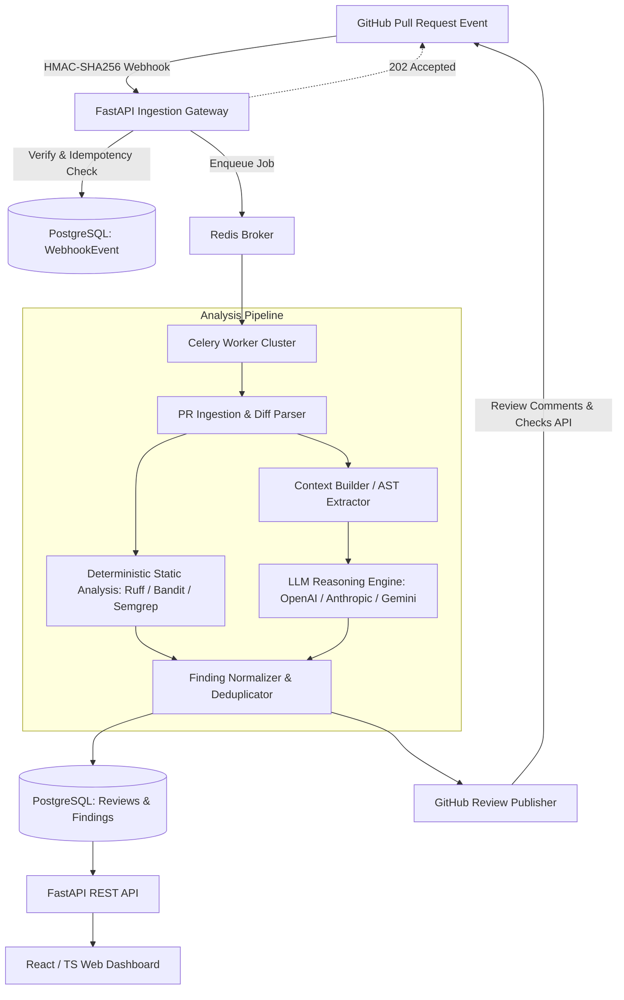

# AI-Powered Code Review Platform

A production-grade, distributed, hybrid AI and static-analysis platform that automatically analyzes GitHub Pull Requests, validates findings, deduplicates issues, and posts high-signal, actionable code review comments.

---

## 🌟 Key Architecture & Highlights

* **Hybrid Analysis Engine**: Combines deterministic static analyzers ([Ruff](https://astral.sh/ruff), [Bandit](https://github.com/PyCQA/bandit), [Semgrep](https://semgrep.dev/)) with an LLM-based reasoning engine. Deterministic linters catch style, syntax, and known CVEs; the LLM focuses on logic flaws, concurrency, architecture, and API misuse.
* **Focused Context Extraction**: Avoids blindly dumping entire repositories into an LLM. Extracts exact diff hunks, modified AST nodes (functions/classes), callers/callees, imports, and surrounding scope.
* **Asynchronous & Non-Blocking**: GitHub Webhook deliveries respond in `< 50ms`. Heavy analysis, diff parsing, and AI invocations execute asynchronously via Celery workers powered by Redis.
* **Finding Deduplication & Normalization**: Standardizes findings from multiple analyzers into a unified schema, performs semantic and line-range deduplication, and suppresses false positives.
* **GitHub Native Integration**: Posts line-specific GitHub review comments with code suggestions, summary checks via GitHub Checks API, and status reporting.
* **Enterprise Security & Multi-Tenancy**: Webhook HMAC-SHA256 signature verification, GitHub App token generation with AES-256-GCM token encryption, tenant isolation, and strict prompt injection defenses.
* **Full Observability**: Structured JSON logging, Prometheus metrics, distributed tracing hooks, and comprehensive audit logs.

---

## 🏗️ Architecture Overview



---

## 🚀 Technology Stack

| Layer | Technologies |
|---|---|
| **Backend API** | Python 3.11+, FastAPI, Pydantic v2, SQLAlchemy 2.0 (Asyncio) |
| **Worker & Queue** | Celery, Redis |
| **Database** | PostgreSQL 16+ (AsyncPG, JSONB, Composite Indexes) |
| **Static Analyzers** | Python AST, Ruff, Bandit, Semgrep CLI |
| **AI Integration** | Provider-agnostic LLM interface (OpenAI, Anthropic, Gemini) with structured output validation |
| **Frontend** | React 18, TypeScript, Tailwind CSS, Vite |
| **Infrastructure** | Docker, Docker Compose, GitHub Actions CI/CD |
| **Observability** | Prometheus client, Structlog / Python logging, Healthchecks |

---

## 📂 Repository Structure

```
.
├── backend/
│   ├── app/
│   │   ├── api/             # API v1 routes & dependencies
│   │   ├── core/            # Configuration, database, redis, security, logging
│   │   ├── models/          # SQLAlchemy ORM models
│   │   ├── schemas/         # Pydantic v2 request/response & finding schemas
│   │   ├── modules/         # Domain-driven modular monolith modules:
│   │   │   ├── auth/        # Authentication & RBAC
│   │   │   ├── github/      # GitHub App, installation tokens, webhook verifier
│   │   │   ├── pull_requests/ # Git diff parser, AST context extractor
│   │   │   ├── analyzers/   # Ruff, Bandit, Semgrep runners
│   │   │   ├── ai_engine/   # LLM client abstractions, prompt templates, validators
│   │   │   ├── findings/    # Normalizer, deduplicator, confidence ranker
│   │   │   ├── reviews/     # Orchestrator & state machine
│   │   │   └── publisher/   # GitHub PR inline comment & checks poster
│   │   └── workers/         # Celery application & task definitions
│   └── tests/               # Unit, integration, webhook, and e2e tests
├── frontend/                # React / TypeScript dashboard
├── docs/
│   ├── adr/                 # Architecture Decision Records
│   ├── PRD.md               # Product Requirements Document
│   ├── SYSTEM_DESIGN.md     # Detailed System Design & Dataflow
│   ├── DATABASE.md          # Database schema & entity relationships
│   ├── API_SPEC.md          # REST API specifications
│   ├── SECURITY.md          # Security architecture & threat modeling
│   ├── AI_REVIEW_DESIGN.md  # LLM prompts, context extraction & validation
│   ├── TESTING.md           # Testing strategy & coverage guidelines
│   ├── ROADMAP.md           # Phased implementation roadmap
│   └── ENGINEERING_GUIDELINES.md # Engineering standards & coding conventions
├── infrastructure/          # Dockerfiles, docker-compose, k8s/helm manifests
├── scripts/                 # Seed scripts, local setup helpers
├── .env.example             # Environment variable template
└── docker-compose.yml       # Local development multi-container setup
```

---

## 📖 Documentation Index

For in-depth architectural and implementation documentation:

* [Product Requirements Document (PRD)](./PRD.md)
* [System Design Document](./SYSTEM_DESIGN.md)
* [Database Design & Schema](./DATABASE.md)
* [API Specification](./API_SPEC.md)
* [Security & Threat Model](./SECURITY.md)
* [AI Review & Context Engine](./AI_REVIEW_DESIGN.md)
* [Testing Strategy](./TESTING.md)
* [Implementation Roadmap](./ROADMAP.md)
* [Engineering Guidelines](./ENGINEERING_GUIDELINES.md)
* [Architecture Decision Records (ADRs)](./docs/adr/)

---

## 🛠️ Quickstart (Development Setup)

*Detailed setup instructions will be updated as the implementation phases roll out.*

1. **Clone the repository**:
   ```bash
   git clone <repo-url>
   cd code_reviewer
   ```

2. **Configure environment variables**:
   ```bash
   cp .env.example .env
   ```

3. **Start local services via Docker Compose**:
   ```bash
   docker-compose up -d postgres redis
   ```

---

## 📄 License
MIT License.
