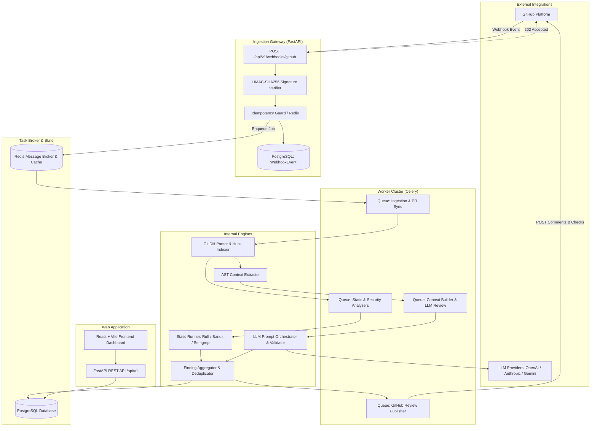

# System Design Document

## 1. System Overview & Architectural Principles

The AI-Powered Code Review Platform is structured as a **modular monolith** backend paired with an asynchronous distributed task processing pipeline and a modern single-page frontend.

### Core Architectural Decisions:
1. **Separation of Gateway and Compute**: Fast, synchronous HTTP ingestion with immediate asynchronous dispatch to worker queues. Webhook delivery never waits for analysis.
2. **Hybrid Static + AI Analysis**: Deterministic tools handle syntactic, stylistic, and static CVE checks; AI handles semantic, architectural, concurrency, and edge-case reasoning.
3. **Focused Context Extraction**: The LLM receives targeted diff hunks, surrounding AST scopes (enclosing functions/classes), and imported dependencies—never the entire raw codebase.
4. **Idempotency & Deduplication by Design**: Multi-layer deduplication at the webhook level, job level, and finding level.

---

## 2. Component Decomposition



---

## 3. End-to-End Data Flow

### Step 1: Webhook Ingestion & Gatekeeping (< 50ms)
1. GitHub delivers a `pull_request` event (actions: `opened`, `synchronize`, `reopened`).
2. Gateway verifies `X-Hub-Signature-256` against configured GitHub Webhook Secret using constant-time comparison (`hmac.compare_digest`).
3. Checks idempotency in Redis: Key `idemp:wh:{delivery_id}` with 24-hour TTL. If exists, returns `200 OK (Duplicate Ignored)`.
4. Saves raw payload to `webhook_events` table with status `RECEIVED`.
5. Dispatches task `process_pull_request_webhook.delay(webhook_event_id)` to Celery.
6. Returns `202 Accepted` to GitHub.

### Step 2: PR Fetching & Git Diff Parsing
1. Worker retrieves installation token using GitHub App Private Key (cached in Redis for 50 minutes).
2. Fetches PR metadata and raw patch/diff via GitHub API.
3. Parses unified diff into structured file hunks:
   * Added lines (`+`), removed lines (`-`), context lines (` `).
   * Exact hunk header line offsets: `@@ -old_start,old_count +new_start,new_count @@`.
   * Maps every added/modified line to its precise **diff position** (required by GitHub PR Review Comments API).
4. Stores changed files in `pull_request_files` table.

### Step 3: Focused Context Extraction
Instead of sending the whole file or entire repository:
1. Parse modified Python files into AST using `ast.parse()`.
2. Map modified line numbers to the enclosing AST node:
   * Enclosing function/method definition (arguments, type hints, docstring).
   * Enclosing class definition and class attributes.
   * Decorators applied to the function/class.
3. Extract file-level imports to understand available libraries and external symbols.
4. If a changed function calls another function within the same module, extract the signature and summary of the callee.
5. Assemble compact, high-relevance prompt context payload:
   ```json
   {
     "file_path": "app/services/payment.py",
     "modified_hunks": ["@@ -45,10 +45,18 @@ ..."],
     "enclosing_symbol": "process_refund(order_id: UUID, amount: Decimal) -> RefundResult",
     "local_context_lines": "def process_refund(...) -> ...\n  # 15 lines before/after hunk\n",
     "imported_modules": ["stripe", "sqlalchemy.ext.asyncio", "app.models.order"]
   }
   ```

### Step 4: Parallel Analysis Execution
The worker pipeline forks into two concurrent branches:

#### Branch A: Deterministic Static & Security Analysis
* Invokes **Ruff** (linting, syntax, performance checks) with `--output-format=json`.
* Invokes **Bandit** (AST-based security scan) with `-f json`.
* Invokes **Semgrep** (security rule pack) with `--json`.
* Scanners run against target files in isolated subdirectories with strict execution timeout (default 60s) and read-only filesystem limits.
* Parsed JSON output is transformed into standardized `RawFinding` objects.

#### Branch B: Context-Aware LLM Review
* Assembles system prompt with strict role guidelines:
  * Expert Staff Security & Systems Engineer.
  * Look for: logic flaws, unhandled exceptions, race conditions, auth bypasses, resource leaks, breaking API changes.
  * Do NOT comment on: formatting, variable naming preferences, missing comments, or issues already captured by standard linters.
* Injects diff and AST context inside `<untrusted_code_diff>` tags with prompt injection mitigations.
* Requests structured JSON output using provider's structured output mode (JSON Schema / Pydantic validation).

### Step 5: Finding Normalization & Deduplication
1. **Schema Standardization**: Convert all findings into standard `ReviewFinding` format:
   * `file_path`, `line_start`, `line_end`, `title`, `description`, `suggested_fix`, `severity`, `category`, `confidence`, `source`.
2. **Deduplication Engine**:
   * If static analyzer (e.g. Bandit) and LLM flag the same line range with overlapping category (e.g. `SQL_INJECTION` / `SECURITY`), merge them into a single finding.
   * Mark source as `HYBRID (Bandit + AI)` and boost confidence to `1.0`.
3. **Diff Range Validation**:
   * Check whether the finding's `line_start` falls directly within the PR diff hunk.
   * If yes: set `is_in_diff = True` and map to GitHub diff `position`.
   * If no: set `is_in_diff = False` (will be included in PR summary, not inline comment).
4. **Suppression & Filtering**:
   * Drop findings below repository-configured severity/confidence thresholds.
   * Drop findings suppressed by repo config (`.codereview.yml` or global settings).

### Step 6: GitHub Review Publishing
1. Create a `CheckRun` on GitHub via Checks API (status: `in_progress`).
2. Batch inline comments:
   * Construct `pull_request_review` payload with `comments` array matching diff `commit_id`, `path`, and `line`.
   * Attach GitHub-compatible Markdown suggestion blocks:
     ````markdown
     ```suggestion
     new_sanitized_code()
     ```
     ````
3. If no issues found: publish positive approval or neutral summary.
4. Complete the `CheckRun` with final conclusion (`success`, `neutral`, `failure`).
5. Persist final results and state transitions into PostgreSQL.

---

## 4. Worker & Queue Architecture

Celery is configured with dedicated queues to prevent heavy AI tasks or linter runs from starving fast tasks:

| Queue Name | Concurrency / Worker Pool | Task Types | SLA / Timeout |
|---|---|---|---|
| `webhooks` | High concurrency (gevent / eventlet or pre-fork) | Webhook payload validation, DB event logging, PR diff sync | < 5 seconds |
| `static_analysis` | Pre-fork workers (CPU-bound) | Ruff, Bandit, Semgrep subprocess execution | 60 seconds per job |
| `ai_review` | High I/O concurrency | AST context compilation, LLM API calls, response parsing | 90 seconds per job |
| `publishing` | Standard I/O workers | GitHub API comment batching, CheckRun updates, Webhooks | 15 seconds per job |

### Dead-Letter Queue (DLQ) & Retries
* All tasks implement exponential backoff with jitter: `default_retry_delay=5`, `max_retries=3`.
* Unrecoverable errors (e.g., malformed payloads, invalid repo tokens) are routed to a DLQ and logged to `audit_logs` with full stack traces.

---

## 5. Scalability & High-Volume Considerations

1. **Large PR Throttling**: PRs exceeding 50 changed files or 5,000 modified lines are flagged as `TOO_LARGE`. The system runs static analysis on modified files up to the cap and asks the developer to split the PR, avoiding worker OOM or massive token spend.
2. **Review Supersession**: If a new commit (`synchronize` webhook) arrives for a PR that currently has an active review in progress, the worker checks an atomic Redis cancel-flag (`cancel:pr:{repo_id}:{pr_number}`) and aborts the obsolete review job early.
3. **GitHub Rate Limit Management**: Uses Redis to track GitHub App installation rate limits. Implements automatic backoff when approaching 90% of rate limits.
4. **Database Connection Pooling**: SQLAlchemy 2.0 AsyncPG pool with `pool_size=20`, `max_overflow=10`, and statement caching.
