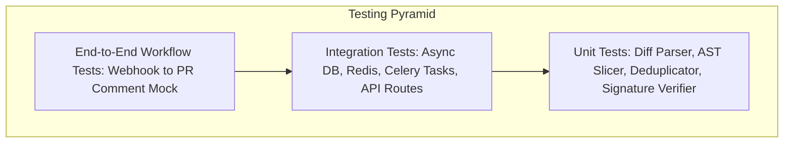

# Testing Strategy & Quality Assurance Plan

## 1. Testing Philosophy & Coverage Target

In a production-grade code review platform that comments on real pull requests and handles sensitive source code, bugs can lead to broken CI pipelines, spam comments, and customer frustration. Testing is treated as a first-class engineering discipline.

### Target Coverage:
* **Core Business Logic (Diff parsing, AST extraction, Deduplication, Verification)**: **> 90%**
* **API Endpoints & Webhook Ingestion**: **> 85%**
* **External Client Wrappers (GitHub, LLM, Linters)**: Mocked with strict contract validation.

---

## 2. Test Architecture & Layers



### 2.1 Unit Tests (`backend/tests/unit/`)
* **Execution**: In-memory, sub-second execution, zero external dependencies.
* **Key Targets**:
  * `test_github_signature.py`: Valid HMAC-SHA256, tampered payloads, missing headers, replay timing.
  * `test_diff_parser.py`: Unified diff hunk extraction, additions/deletions counting, diff line position calculation.
  * `test_ast_context.py`: Python AST extraction for top-level functions, class methods, async functions, decorators, and imports.
  * `test_finding_deduplicator.py`: Merging overlapping static and AI findings, priority ordering, confidence scoring.
  * `test_prompt_builder.py`: Context bounding, secret redaction, XML delimiter escaping.
  * `test_schema_validation.py`: Pydantic validation of LLM outputs, rejection of malformed or out-of-range findings.

### 2.2 Integration Tests (`backend/tests/integration/`)
* **Execution**: Uses PostgreSQL and Redis test containers or isolated test instances.
* **Key Targets**:
  * `test_webhook_api.py`: `POST /api/v1/webhooks/github` handling valid, invalid, and duplicate events.
  * `test_repository_crud.py`: Organization tenant isolation, repository creation, member RBAC checks.
  * `test_review_persistence.py`: Transactional persistence of reviews, jobs, and findings.
  * `test_celery_pipeline.py`: Celery tasks running with `task_always_eager=True` verifying task chain execution.

### 2.3 Analyzer Subprocess & External Mock Tests
* **Static Analyzers**: Tested against fixed JSON fixtures representing outputs from `ruff check --output-format=json`, `bandit -f json`, and `semgrep --json`.
* **LLM Engine**:
  * `MockLLMClient`: Simulates LLM responses with realistic structured JSON.
  * Tests for: rate-limit retries (HTTP 429), provider timeout, corrupted JSON recovery, and empty findings list.
* **GitHub API Client**:
  * Uses `pytest-mock` or `respx` to mock GitHub REST/GraphQL endpoints for installation token generation, diff fetching, and review comment publishing.

### 2.4 End-to-End (E2E) Scenario Tests (`backend/tests/e2e/`)
Simulates the entire lifecycle without contacting external internet services:
1. Deliver a mocked `pull_request.opened` webhook.
2. Ingest payload and assert `202 Accepted` response.
3. Execute Celery worker task synchronously.
4. Verify PR diff is parsed and AST context is extracted.
5. Verify static analyzer output and LLM output are merged.
6. Verify review records and findings are persisted in PostgreSQL.
7. Verify that the GitHub mock client received the batch review comment payload with proper line positions and suggestions.

---

## 3. Test Fixture Strategy

* **Standardized Fixtures** located in `backend/tests/fixtures/`:
  * `sample_diffs/`: Realistic diffs (simple bug fix, multi-file PR, SQL injection change, lockfile diff).
  * `sample_webhooks/`: Real GitHub webhook payloads (`pr_opened.json`, `pr_sync.json`).
  * `tool_outputs/`: Raw CLI outputs from Ruff, Bandit, Semgrep.
  * `mock_llm_responses/`: Valid and adversarial LLM JSON outputs.

---

## 4. Continuous Integration (CI) Pipeline

Every pull request to this repository triggers the GitHub Actions CI workflow:
1. **Linting & Formatting**:
   ```bash
   ruff check .
   ruff format --check .
   ```
2. **Type Checking**:
   ```bash
   mypy app/
   ```
3. **Automated Test Suite**:
   ```bash
   pytest --cov=app --cov-report=term-missing --cov-report=xml
   ```
4. **Security Scan**:
   ```bash
   bandit -r app/
   pip-audit
   ```
5. **Build Verification**:
   ```bash
   docker build -t code-review-backend:test -f backend/Dockerfile .
   ```
