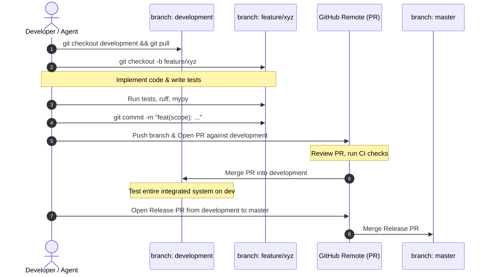

# Git Workflow & Branching Architecture

This document governs the version control strategy for the AI Code Review Platform.

---

## 1. Branch Topology & Roles

```
[ master ] (Production / Stable Releases)
     ▲
     │  Merge via Release PR (after full testing & QA on dev)
[ development ] (Integration / Pre-Release)
     ▲
     │  Merge via Feature PR (after passing unit & integration tests)
[ feature/XYZ ] (Active Feature Branch)
```

### 1.1 `master` Branch
* **Purpose**: Represents production-ready, release-tagged code.
* **Rules**:
  * Direct commits are strictly prohibited.
  * Direct pushes are prohibited.
  * Code enters `master` **only** via a Pull Request from `development`.
  * Every merge to `master` represents a verified release candidate.

### 1.2 `development` Branch
* **Purpose**: Integration trunk where all features converge.
* **Rules**:
  * Direct commits to `development` are prohibited.
  * Merges into `development` occur **only** via Pull Requests from `feature/*`, `fix/*`, `chore/*`, or `docs/*` branches.
  * All automated tests, linters, and type-checks must pass before merging.

### 1.3 Temporary Branches (`feature/*`, `fix/*`, `chore/*`, `docs/*`)
* **Branch Naming Standard**:
  * `feature/<short-name>`: e.g. `feature/diff-parser`, `feature/webhook-verification`
  * `fix/<short-name>`: e.g. `fix/celery-retry-timeout`, `fix/ast-async-def-parsing`
  * `chore/<short-name>`: e.g. `chore/docker-compose-redis-upgrade`, `chore/ruff-rules`
  * `docs/<short-name>`: e.g. `docs/api-spec-update`, `docs/adr-0005`
* **Lifecycle**:
  1. Branch created off the latest `development` branch.
  2. Implement changes, write tests, verify locally.
  3. Commit using Conventional Commits.
  4. Submit Pull Request against `development`.
  5. Merge into `development` using squash or rebase merge to keep history clean.
  6. Delete temporary branch upon successful merge.

---

## 2. Step-by-Step Feature Lifecycle



---

## 3. Merge Protocols & Policies

1. **Squash & Merge (Preferred for Features)**: Merging a feature branch into `development` uses squash-and-merge to retain a clean, single-commit narrative per feature on `development`.
2. **Merge Commit (for `development` to `master`)**: When promoting `development` into `master`, use a standard merge commit or release tag (e.g. `v0.1.0`) to preserve the integration timeline.
3. **Never Force Push**: Never run `git push --force` on `development` or `master`.
